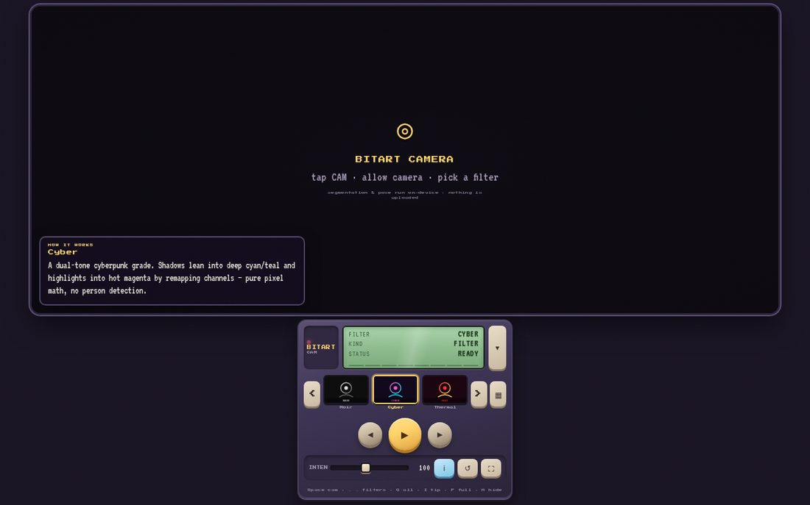
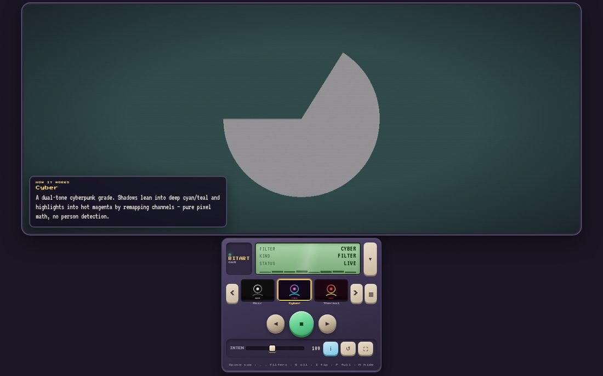
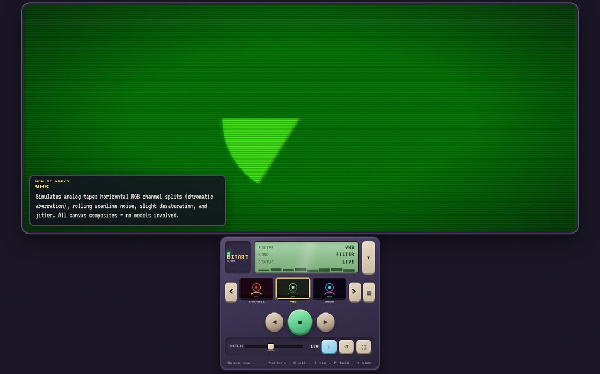
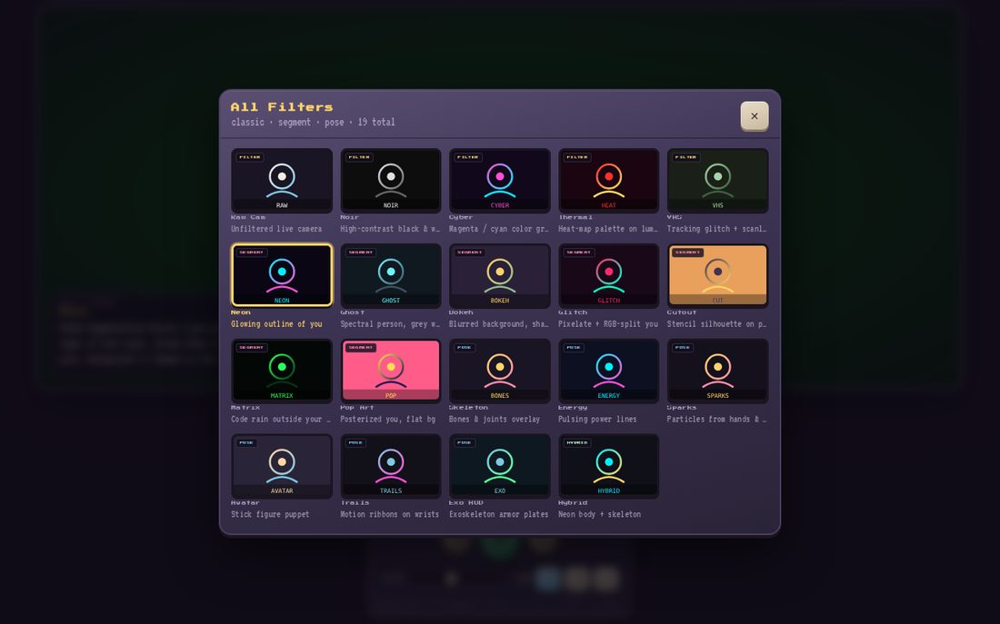

# Bitart Camera

Live webcam filters with **person segmentation** and a **pose playground** — same retro shell as [bitart-visualizer](https://github.com/Rohsomeness/bitart-visualizer) and [bitart-ambient](https://github.com/Rohsomeness/bitart-ambient).

Everything runs **on-device** in your browser (MediaPipe). Video is never uploaded.

**Live demo:** [rohsomeness.github.io/bitart-camera](https://rohsomeness.github.io/bitart-camera/)

## Screenshots



*Retro player shell before the camera starts.*



*Cyber classic filter — magenta/cyan grade on the live feed (plus the how-it-works tip).*



*VHS — tracking glitch, chromatic split, and scanlines.*



*All-filters grid (classic · segment · pose · hybrid).*

## Filters

| Kind | Modes |
|------|--------|
| **Classic** | Raw Cam, Noir, Cyber, Thermal, VHS |
| **Segment** | Neon, Ghost, Bokeh, Glitch, Cutout, Matrix, Pop Art |
| **Pose** | Skeleton, Energy, Sparks, Avatar, Trails, Exo HUD |
| **Hybrid** | Neon body + skeleton |

Tap **ℹ** (or press `I`) for a short “how it works” blurb on the active filter.

## Controls

| Input | Action |
|-------|--------|
| Space / big button | Start / stop camera |
| ← → | Prev / next filter |
| G / ▦ | All-filters grid |
| I / ℹ | Toggle how-it-works tip |
| F | Fullscreen |
| H | Hide / show player |
| ↺ | Flip camera (front / back) |
| INTEN | Effect strength |

Deep-link a mode: `?mode=neon`

## Stack

- `getUserMedia` + canvas
- [MediaPipe Tasks Vision](https://ai.google.dev/edge/mediapipe/solutions/vision/image_segmenter) — Selfie Segmenter + Pose Landmarker (lite)
- Static GitHub Pages (no build step)

## Local

Serve over HTTPS or localhost (camera APIs require a secure context):

```bash
npx --yes serve .
```

Then open the printed URL and allow camera access.
